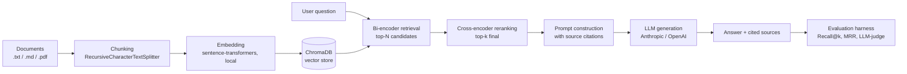

# DocuMind — Retrieval-Augmented Generation over Internal Documents

DocuMind is a full Retrieval-Augmented Generation (RAG) system: it ingests documents,
indexes them in a vector database, retrieves the most relevant passages for a question,
and generates a grounded, cited answer with an LLM — with a built-in evaluation harness
that measures whether the retrieval and answers are actually any good.

It's built as a small production-style system rather than a notebook: a real ingestion
pipeline, a served API, a chat UI, tests, CI, and Docker packaging.

## Why this exists

Most "RAG demo" projects stop at "it gives an answer that looks plausible." That's not
evidence the system works. DocuMind includes an evaluation module that measures:

- **Retrieval quality** — Recall@k and Mean Reciprocal Rank (MRR) against a labeled
  question set, so you can tell if the retriever is finding the right documents at all.
- **Answer quality** — an LLM-as-judge step that scores generated answers for
  **faithfulness** (is every claim actually supported by the retrieved context, or did
  the model hallucinate beyond it?) and **relevance** (does the answer address the
  question?).

## Architecture



**Design choices worth calling out in an interview:**
- **Local embeddings, remote generation.** Embedding is done locally with
  `sentence-transformers` (free, no API key, no per-query cost) — only the final
  generation step calls an LLM API. This keeps indexing cheap and fast to iterate on.
- **Two-stage retrieval.** A fast bi-encoder (cosine similarity in Chroma) fetches a
  broad candidate set, then a slower but more accurate cross-encoder reranks just that
  shortlist. This is the standard pattern used in production retrieval systems because
  running the cross-encoder over the whole corpus would be too slow.
- **Provider-agnostic generation.** The pipeline works with Anthropic, OpenAI, or in a
  retrieval-only mode with no LLM at all — useful for testing/demoing the retrieval half
  without spending on API calls.
- **Grounded prompting + citations.** The system prompt explicitly forbids the model
  from using outside knowledge and requires source citations, directly reducing
  hallucination — and the evaluation harness checks that this constraint is actually
  being followed, not just requested.

## Project structure

```
documind/
├── app.py                      # Streamlit chat UI
├── api.py                      # FastAPI REST service
├── src/
│   ├── config.py                # Centralized settings (env-driven)
│   ├── ingest.py                 # Load → chunk → embed → persist to Chroma
│   ├── rag_pipeline.py           # Retrieve → rerank → prompt → generate
│   └── evaluate.py               # Retrieval metrics + LLM-as-judge scoring
├── data/sample_docs/            # Demo corpus (privacy policy, handbook, runbook)
├── eval/eval_set.json           # Labeled question→source pairs for evaluation
├── tests/test_rag.py            # Unit tests (mocked embeddings/LLM, no network needed)
├── .github/workflows/ci.yml     # GitHub Actions: runs tests on every push
├── Dockerfile
├── requirements.txt
└── .env.example
```

## Setup

```bash
git clone <your-repo-url>
cd documind
python -m venv venv && source venv/bin/activate   # Windows: venv\Scripts\activate
pip install -r requirements.txt

cp .env.example .env
# then edit .env and add ANTHROPIC_API_KEY or OPENAI_API_KEY
```

### Build the index

```bash
python -m src.ingest --source data/sample_docs
```

To index your own documents instead, point `--source` at any folder of `.txt`, `.md`,
or `.pdf` files.

### Run the chat UI

```bash
streamlit run app.py
```

### Run the API

```bash
uvicorn api:app --reload --port 8000
curl -X POST http://localhost:8000/query \
     -H "Content-Type: application/json" \
     -d '{"question": "How many sick days do employees get?"}'
```

### Run evaluation

```bash
python -m src.evaluate
# writes a full report to eval/eval_report.json
```

### Run tests

```bash
pytest tests/ -v
```

### Run with Docker

```bash
docker build -t documind .
docker run -p 8000:8000 --env-file .env documind
```

## Configuration

All settings are environment-driven (see `.env.example`): chunk size/overlap, top-k,
whether reranking is enabled, which LLM provider and model to use, temperature, and
max tokens. Nothing is hardcoded in the pipeline code.

## Extending this project

Natural next steps if you want to push this further for a portfolio:
- Swap the demo corpus for a real domain (legal contracts, medical literature, your own
  codebase's docs) — the pipeline is domain-agnostic.
- Add hybrid search (BM25 + dense vectors) for better exact-match recall on names/numbers.
- Add conversation memory so follow-up questions can refer to prior turns.
- Track evaluation results over time (e.g. log to a simple SQLite table or W&B) to show
  regression testing across pipeline changes.
- Deploy the API to a cloud service (Cloud Run, ECS, Fly.io) and put the Streamlit UI
  or a small frontend in front of it.

## Resume bullet points

- *"Built a Retrieval-Augmented Generation system with two-stage retrieval (bi-encoder +
  cross-encoder reranking) and grounded, cited generation, reducing hallucination risk
  through constrained prompting."*
- *"Designed and implemented an evaluation harness measuring retrieval Recall@k/MRR and
  LLM-judged answer faithfulness, enabling data-driven iteration on retrieval quality."*
- *"Shipped the RAG pipeline as both a FastAPI service and a Streamlit interface, with a
  Dockerized deployment and CI pipeline running automated tests on every push."*
